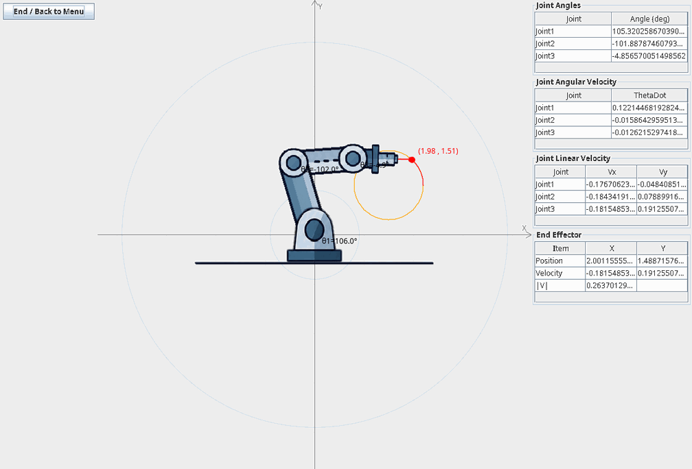
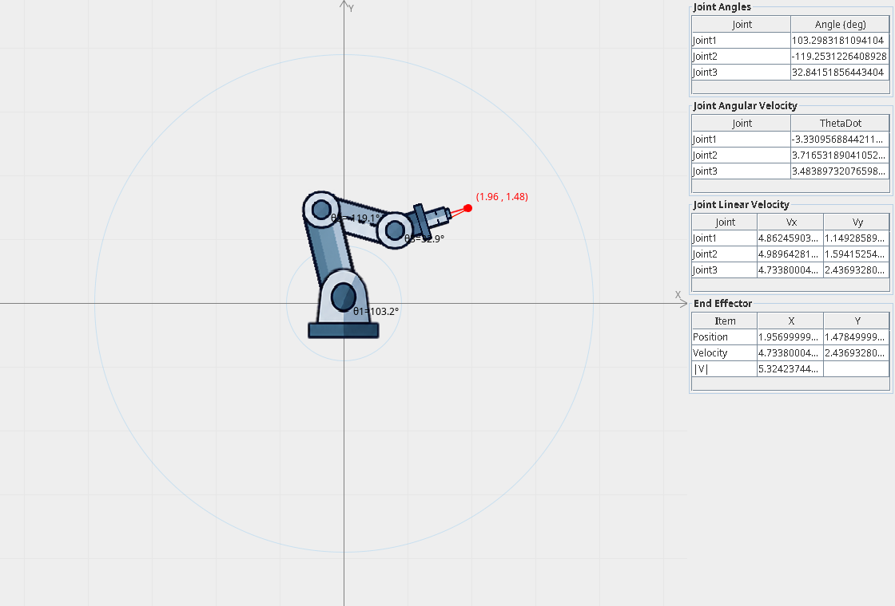
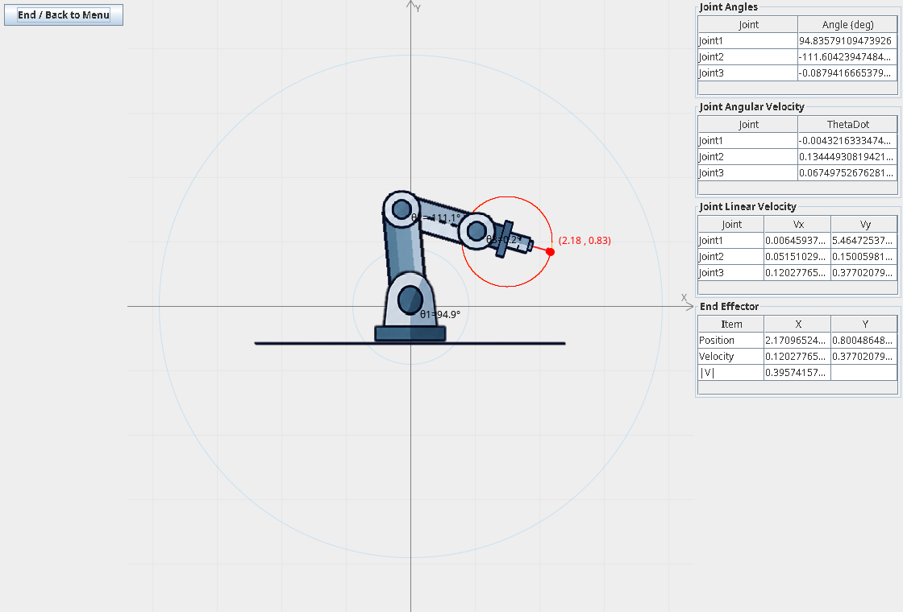
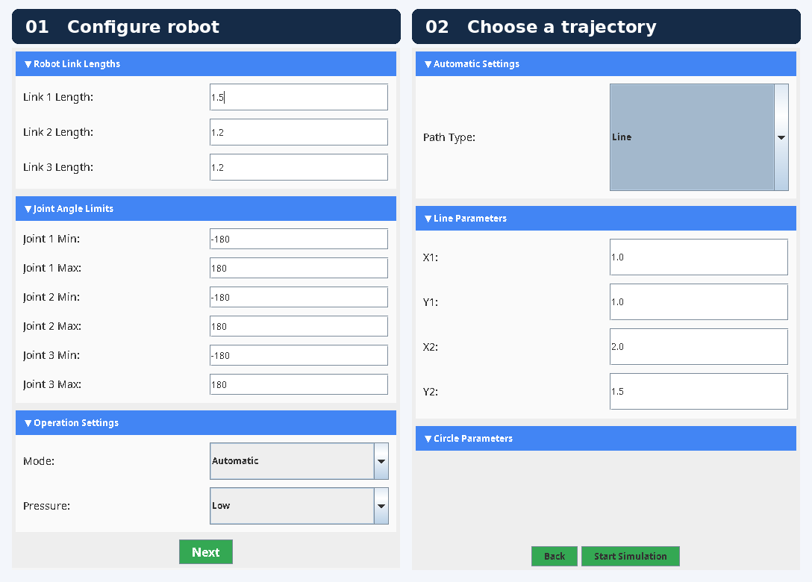
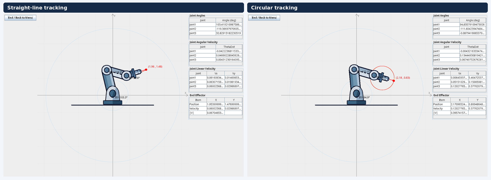
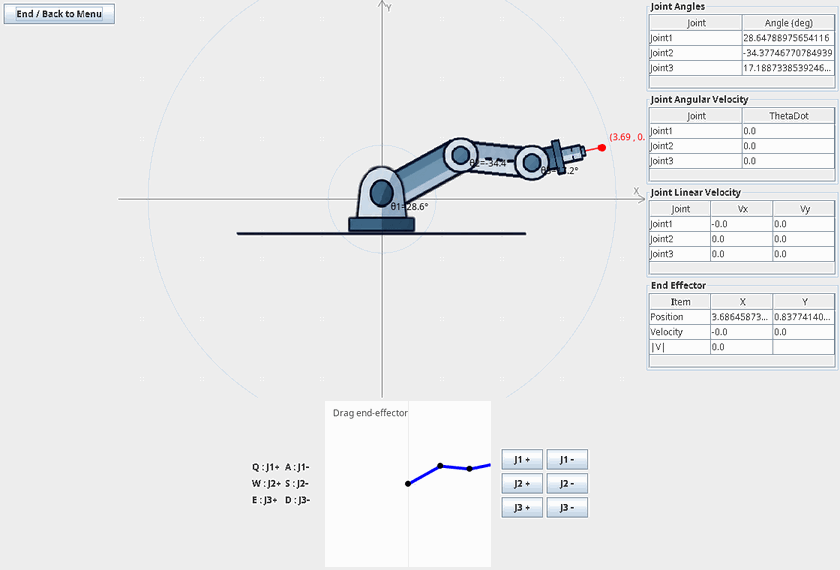
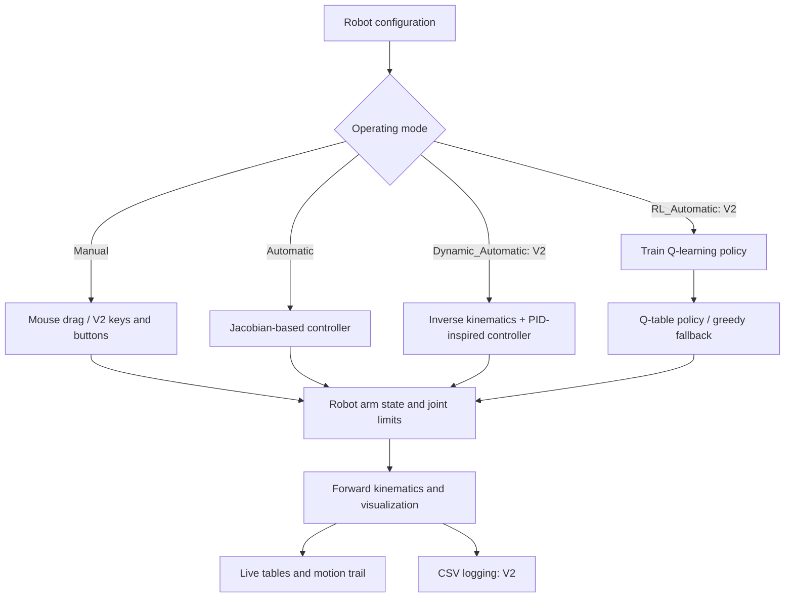
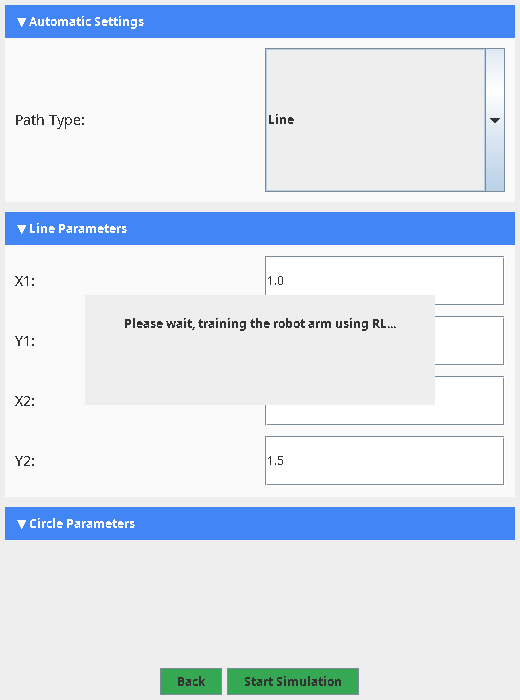
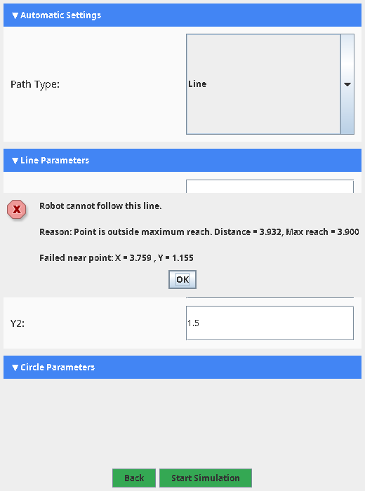
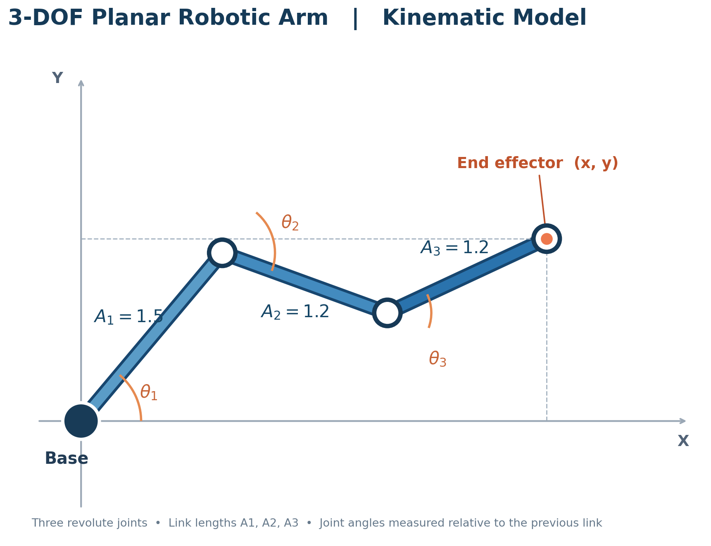

# 3-DOF Planar Robotic Arm Simulator

**An interactive Java Swing simulator for a three-link planar robot arm, from manual manipulation and Jacobian-based path tracking (V1) to reinforcement learning and dynamic-style control (V2).**


This repository contains **two independent versions** of the same educational robotics project. Both model a planar manipulator with **three revolute joints**, support configurable link lengths and joint-angle limits, and visualize the robot's motion in a desktop application. **V2 extends V1** with additional control strategies, more detailed path validation, manual keyboard/button controls, and CSV telemetry logging.

The project uses only the Java standard library; no third-party packages, build framework, or robotic hardware are required.



*Real frames captured from the running V2 Java Swing simulator: circular-path tracking.*

## Contents

- [Features](#features)
- [V1 vs V2](#v1-vs-v2)
- [Screenshots and demo](#screenshots-and-demo)
- [Getting started](#getting-started)
- [How to use](#how-to-use)
- [Controls and algorithms](#controls-and-algorithms)
- [Mathematical model](#mathematical-model)
- [CSV data logging (V2)](#csv-data-logging-v2)
- [Project structure](#project-structure)
- [Implementation notes and limitations](#implementation-notes-and-limitations)
- [Included screenshots, diagram and GIFs](#included-screenshots-diagram-and-gifs)
- [Future improvements](#future-improvements)
- [License](#license)

## Features

**Shared by V1 and V2**

- Three-link, three-joint planar arm with configurable link lengths (`A1`, `A2`, `A3`).
- Joint-angle limits configured in **degrees** and converted internally to radians.
- **Automatic mode:** follow a straight-line or circular target path using Jacobian-based position control.
- **Manual mode:** drag the end effector in a small 2D control panel to adjust the arm pose through inverse kinematics.
- Forward kinematics, inverse kinematics, joint constraints, and position/velocity calculations.
- Animated simulation with coordinate axes, workspace guides, target path, and a trace of end-effector motion.
- Live tables for joint angles, angular velocities, linear velocities, and end-effector values.
- Configurable **Low / Medium / High** drawing-pressure setting. In the current implementation, this setting changes the **trail color only**; it does **not** simulate contact force.

**Added or expanded in V2**

- **RL_Automatic:** train a tabular Q-learning agent for the chosen path, then use its learned policy for tracking.
- **Dynamic_Automatic:** track inverse-kinematics angle targets using a PID-inspired, acceleration-style joint controller.
- More detailed reachability checks, including sampled path points, joint limits, continuity checks, and a simple self-collision heuristic.
- Manual control by **keyboard shortcuts**, **joint +/- buttons**, or **mouse dragging**.
- Automatic, timestamped **CSV telemetry output** during simulations.
- **End / Back to Menu** button in the simulation window.
- Improved reachability error messages that identify the approximate failed path point and reason.

## V1 vs V2

| Capability | V1 | V2 |
|---|:---:|:---:|
| Three-link planar robot visualization | ✅ | ✅ |
| Custom link lengths and joint-angle limits | ✅ | ✅ |
| Manual end-effector dragging | ✅ | ✅ |
| Manual keyboard and joint-button control | — | ✅ |
| Jacobian-based automatic path tracking | ✅ | ✅ |
| Straight-line and circular paths | ✅ | ✅ |
| Basic geometric / sampled angular path checks | ✅ | ✅ |
| Detailed sampled reachability diagnostics | — | ✅ |
| Tabular Q-learning control | — | ✅ |
| PID-inspired dynamic-style control | — | ✅ |
| Live joint / end-effector tables | ✅ | ✅ |
| Automatic CSV recording | — | ✅ |
| Back-to-menu button | — | ✅ |

**Which version should I run?** Choose **V1** to study the core kinematics, manual interaction, and Jacobian control with fewer moving parts. Choose **V2** to explore different tracking controllers, extra user controls, and recorded motion data.

## Screenshots and demo

### V1 — Original simulator



### V2 — Extended simulator



### Configuration screen



## Getting started

### Requirements

- **JDK 11 or newer** (Java 21 was used to verify that both versions compile).
- Windows, macOS, or Linux with a desktop environment that supports Java Swing.
- No Maven, Gradle, Python, external Java dependencies, or physical robot required.

### Option A: Run from a terminal (macOS / Linux / Git Bash)

Clone or download the repository, then run **one version at a time**:

```bash
# Start from the repository root.
cd Robot_V2
mkdir -p build
javac -encoding UTF-8 -d build src/*.java
java -cp build RobotSimulatorFrame
```

To run the original version, return to the repository root and repeat the same commands inside `Robot_V1`:

```bash
cd Robot_V1
mkdir -p build
javac -encoding UTF-8 -d build src/*.java
java -cp build RobotSimulatorFrame
```

**Important:** Run the `java` command while the terminal's **working directory is `Robot_V1` or `Robot_V2`**, as appropriate. Each version loads its `link*.png`, `joint*.png`, and other image assets using **relative file paths**. Launching from the repository root can cause images to fail to load.

### Option B: Run from Windows PowerShell

From the repository root:

```powershell
cd Robot_V2
New-Item -ItemType Directory -Force build | Out-Null
javac -encoding UTF-8 -d build (Get-ChildItem .\src\*.java).FullName
java -cp build RobotSimulatorFrame
```

Replace `Robot_V2` with `Robot_V1` to launch V1.

### Option C: Run in IntelliJ IDEA

1. Open **`Robot_V1` or `Robot_V2`** as a separate project/module.
2. Select an installed **JDK** as the Project SDK.
3. Open `src/RobotSimulatorFrame.java` and run its `main()` method.
4. In the run configuration, make sure **Working directory** points to that version's folder (the folder containing `link1.png` and `joint1.png`).

The `RobotSimulatorFrame` class is the entry point in **both** versions. Do not compile the source folders of V1 and V2 together into the same output directory, because they intentionally contain classes with identical names in the default Java package.

## How to use

### 1. Configure the robot

The first screen lets you choose the **three link lengths**, **minimum and maximum angles for each joint**, **operation mode**, and **drawing-pressure level**. The default link lengths are `1.5`, `1.2`, and `0.8`; the default joint limits are `-180°` to `180°`.

### 2. Select a mode

| GUI mode | Versions | What happens |
|---|---|---|
| `Manual` | V1, V2 | You move the arm interactively. Choosing **Next** opens the simulation directly. |
| `Automatic` | V1, V2 | A Jacobian controller tracks a line or circle. |
| `RL_Automatic` | V2 | A Q-learning agent is trained for the selected path before the simulation window opens. |
| `Dynamic_Automatic` | V2 | An inverse-kinematics target is followed with a PID-inspired controller. |

For an automatic mode, press **Next**, choose **Line** or **Circle**, enter its parameters, and click **Start Simulation**. The program checks path reachability before opening the simulator.

**Line:** Specify a start point `(X1, Y1)` and end point `(X2, Y2)`. Default values: `(1.0, 1.0)` to `(2.0, 1.5)`.

**Circle:** Specify center `(CX, CY)` and radius `R`. The defaults are `(1.5, 1.0), R = 0.7` in V1 and `(1.5, 1.5), R = 0.7` in V2.



### 3. Operate the robot

**Manual mode (V1):** Use the small robot panel to click or drag the end-effector target.

**Manual mode (V2):** Drag the end effector in the mini panel, click `J1 +/-`, `J2 +/-`, `J3 +/-`, or use these keyboard shortcuts:

| Joint | Increase angle | Decrease angle |
|---|:---:|:---:|
| Joint 1 | `Q` | `A` |
| Joint 2 | `W` | `S` |
| Joint 3 | `E` | `D` |

Each V2 manual button/key press changes the corresponding angle by **0.05 radians** (about 2.86°), subject to the configured joint limits.



**Automatic modes:** The robot attempts to reach the starting point and then advance along the selected path. The orange curve/line represents the target; the colored trail shows where the end effector actually traveled. 

**V2 navigation:** Click **End / Back to Menu** to leave the current simulation and return to configuration. In V1, close the simulation window to exit.

## Controls and algorithms

### High-level flow



### Automatic — Jacobian-based tracking (V1 and V2)

The simulator measures the end-effector error and uses the manipulator Jacobian to turn a desired Cartesian movement into joint-angle changes. The implementation uses a Jacobian pseudo-inverse constructed from `Jᵀ(JJᵀ)⁻¹` for the 2D task, with a singularity check and joint-limit clamping.

This is a **kinematic position controller**: it computes joint updates to reduce task-space error, rather than modeling motor torques or forces.

**Implementation:** [`Robot_V1/src/RobotArm.java`](Robot_V1/src/RobotArm.java), [`Robot_V2/src/RobotArm.java`](Robot_V2/src/RobotArm.java), and each version's `RobotSimulatorFrame.java`.

### RL_Automatic — Tabular Q-learning (V2)

V2 implements **Q-learning**, not a deep reinforcement learning network. The training procedure:

1. Samples target positions along the selected line or circle.
2. Represents a state using discretized end-effector position error and three joint angles.
3. Selects one of **27 actions** (each joint changes by `-0.01`, `0`, or `+0.01` radians).
4. Rewards reductions in target distance, penalizes each step, and gives a success bonus when close to the target.
5. Updates a Q-table, then uses learned actions during simulation. For states absent from the Q-table, it uses a one-step greedy distance-reduction fallback.

The current training setup uses **20,000 episodes**, up to **100 steps per episode**, with learning rate `α = 0.5`, discount factor `γ = 0.99`, and a decaying exploration rate. Training runs in a background `SwingWorker`; depending on the computer and the number of visited states, it may take time and use substantial memory. The learned Q-table currently remains **in memory only** and is **not saved for reuse**.

**Implementation:** [`Robot_V2/src/RLController.java`](Robot_V2/src/RLController.java).



### Dynamic_Automatic — PID-inspired tracking (V2)

This controller searches for a suitable inverse-kinematics solution at the current target point, then updates joint angles through a **proportional + integral + derivative-style acceleration equation** with accumulated velocity and a clamped integral term. The controller gains currently configured in the simulation are `Kp = 50`, `Ki = 0.5`, and `Kd = 10`.

**Implementation:** [`Robot_V2/src/DynamicController.java`](Robot_V2/src/DynamicController.java).

### Reachability checking

V1 checks workspace geometry and samples points to assess angular reachability. V2's `ReachabilityChecker` evaluates **200 segments for a line**, **200 sample points for a circle**, candidate end-effector orientations, joint limits, continuity of successive joint solutions, and a basic self-collision heuristic. A failed check reports the approximate point and a reason.


**Implementation:** [`Robot_V2/src/ReachabilityChecker.java`](Robot_V2/src/ReachabilityChecker.java).



## Mathematical model

For link lengths `A₁`, `A₂`, `A₃` and revolute joint angles `θ₁`, `θ₂`, `θ₃`, the end-effector position is:

$$
x = A_1\cos(\theta_1) + A_2\cos(\theta_1+\theta_2) + A_3\cos(\theta_1+\theta_2+\theta_3)
$$

$$
y = A_1\sin(\theta_1) + A_2\sin(\theta_1+\theta_2) + A_3\sin(\theta_1+\theta_2+\theta_3)
$$

The end-effector's Cartesian velocity is related to angular velocity by:

$$
\begin{bmatrix}\dot{x}\\\dot{y}\end{bmatrix}
= J(\boldsymbol{\theta})
\begin{bmatrix}\dot{\theta}_1\\\dot{\theta}_2\\\dot{\theta}_3\end{bmatrix}
$$

Here, `J(θ)` is the **2 × 3** planar manipulator Jacobian calculated from the derivatives of the forward-kinematics equations. Angles are handled internally in **radians**. Link lengths and Cartesian positions use the **same arbitrary length unit** (for example, meters if you interpret the link lengths in meters).



## CSV data logging (V2)

V2 automatically creates a file in its **working directory** using the pattern:

```text
robot_data_YYYYMMDD_HHMMSS.csv
```

The CSV writer records a new row approximately **every 3 seconds**. Recorded values include:

| Group | Fields |
|---|---|
| Time | `Time(s)` |
| Joint angles | `Theta1`, `Theta2`, `Theta3` |
| Joint angular velocities | `ThetaDot1`, `ThetaDot2`, `ThetaDot3` |
| Joint linear velocities | `J1_Vx`, `J1_Vy`, `J2_Vx`, `J2_Vy`, `J3_Vx`, `J3_Vy` |
| End-effector position | `EE_X`, `EE_Y` |
| End-effector velocity | `EE_Vx`, `EE_Vy`, `EE_V_Mag` |

The repository already contains one example recording: [`Robot_V2/robot_data_20260713_222537.csv`](Robot_V2/robot_data_20260713_222537.csv).


## Project structure

```text
.
├── README.md                      # This guide (put it at repository root)
├── Robot_V1/
│   ├── src/
│   │   ├── RobotSimulatorFrame.java   # Entry point / simulation loop
│   │   ├── PreStartFrame.java         # Configuration UI
│   │   ├── RobotArm.java              # Robot kinematics and Jacobian control
│   │   ├── RobotPanel.java            # Main visualization
│   │   ├── MiniRobotPanel.java        # Manual mouse control
│   │   ├── ControlPanel.java          # Live telemetry tables
│   │   ├── LinePath.java, CirclePath.java, Path.java
│   │   └── *TableModel.java           # Table data models
│   ├── link1.png, link2.png, link3.png
│   ├── joint1.png, joint2.png, joint3.png
│   └── Robot.png                      # Component artwork
├── Robot_V2/
│   ├── src/
│   │   ├── RobotSimulatorFrame.java   # Entry point / control-mode selection
│   │   ├── PreStartFrame.java         # Configuration + RL launch
│   │   ├── RobotArm.java              # Robot kinematics
│   │   ├── RLController.java          # Tabular Q-learning
│   │   ├── DynamicController.java     # PID-inspired joint controller
│   │   ├── ReachabilityChecker.java   # Sampled path feasibility
│   │   ├── RobotPanel.java            # Main visualization
│   │   ├── MiniRobotPanel.java        # Drag / keyboard / button control
│   │   ├── ControlPanel.java          # Live telemetry + CSV recording
│   │   ├── LinePath.java, CirclePath.java, Path.java
│   │   └── *TableModel.java           # Table data models
│   ├── link1.png, link2.png, link3.png
│   ├── joint1.png, joint2.png, joint3.png, earth.png
│   ├── Robot.png
│   └── robot_data_20260713_222537.csv  # Example output
└── docs/                             # Captured visual documentation
    ├── images/                         # Screenshots + kinematics schematic
    └── media/                          # Animated demonstrations (.gif)
```

## Implementation notes and limitations

- **Separate applications:** V1 and V2 are independent source trees, not two switchable modes inside a single executable.
- **Desktop only:** The interface is built using Java Swing; it does not run in a browser or use ROS/Gazebo.
- **No third-party dependencies:** All application logic uses the Java standard library.
- **Relative assets:** Image files must stay in the working directory of the version being launched.
- **Pressure visualization only:** Low/Medium/High currently sets trail colors (blue/red/purple), not physical pressure or actuator force.
- **RL training cost:** Q-learning is trained when RL mode starts; model persistence and detailed training-progress metrics are not implemented.

## Included screenshots, diagram and GIFs

The media in this README is **already included** in the repository-ready `docs/` folder. All interface screenshots and animations were captured from the running Java Swing applications, using their real robot assets and controllers. The kinematics diagram is a clean schematic derived from the same three-link planar model.

## Future improvements

Possible next steps include automated tracking-error benchmarks across controllers, persisted RL policies, visible training progress, controller-parameter controls in the UI, stronger inverse-kinematics and reachability validation, improved CSV export, unit tests, and a physically grounded torque-level dynamics model.

---
## Academic Context

Developed as part of the **Fundamentals of Robotics** course.

📅 **Spring 2026**
---


